  

  
  
  

---

## About

Cybersecurity alanında **offensive** ve **defensive** tarafta birlikte çalışıyorum. Yetkili lab ve CTF ortamlarında (Hack The Box) uçtan uca saldırı senaryoları yürütüyorum: **recon → web application testing → exploitation**. Bu saldırgan bakış açısını kendi güvenlik araçlarıma ve gerçek ürünlere yönelik **attack test**'lere dönüştürüyorum.

Araçlarımı ve ürünlerimi **Claude Code** ile **AI-assisted, test-first** bir iş akışıyla geliştiriyorum. Odağım güvenlik tarafı: **threat modeling**, **access control** tasarımı ve bunu otomatik saldırı testleriyle kanıtlamak.

<table>
  <tr>
    <th align="left">Offensive Security</th>
    <th align="left">Defensive Security</th>
    <th align="left">Product Security</th>
  </tr>
  <tr>
    <td valign="top">Recon &amp; OSINT Web application testing OWASP Top 10 (SQLi, XSS, IDOR) Exploitation (lab / CTF)</td>
    <td valign="top">Log analysis Brute-force &amp; credential-stuffing detection MITRE ATT&amp;CK mapping Traffic analysis</td>
    <td valign="top">Multi-tenant isolation (RLS) Cross-tenant attack testing LLM output validation Rate limiting &amp; input validation</td>
  </tr>
</table>

---

## Security Tools

### [LogSentry](https://github.com/MMSolver/logsentry) · SSH/auth log attack detector

SSH loglarında **brute-force**, **user enumeration** ve **successful breach** örüntülerini yakalayan Python CLI aracı. Her bulgu **MITRE ATT&CK** ile eşleniyor (T1110, T1078).

- **Sliding window** ile tespit, LOW → CRITICAL **severity scoring**
- Büyük dosyalar için **memory-safe streaming**, XSS'e karşı korumalı HTML rapor
- 4 rapor formatı (terminal, JSON, CSV, HTML), SIEM/SOC iş akışına uygun
- 29 **pytest** testi, **GitHub Actions CI**

   

### [SPECTER](https://github.com/MMSolver/specter) · multi-agent recon & analysis framework

**Yetkili** penetration test ve CTF çalışmaları için hiyerarşik bir **AI agent** sistemi. Hedefi haritalıyor, servisleri tanımlıyor ve MITRE eşlemeli, önceliklendirilmiş bir **attack plan** çıkarıyor.

- Her ağ işlemi katı bir **scope guard**'dan geçer
- Sadece plan yapar, exploit'i asla kendiliğinden çalıştırmaz (**human approval** şart)
- CVE adayları için **false-positive** kontrolü yapan konsensüs motoru
- 33 test, canlı web dashboard

   

---

## Security Testing on Real Products

> Claude Code ile geliştirildi. Kaynak kodu private (kendi SaaS ürünüm) ya da müşteriye ait olduğu için canlı ürünlere bağlantı veriliyor.

### Sportudent · multi-tenant SaaS · [sportudent.com](https://sportudent.com)

Spor okulları için canlıda olan, ilk ödeme yapan müşterisi bulunan bir ürün. Okullar arası **tenant isolation** modelini tasarladım ve ona saldırdım:

<table>
  <tr>
    <td align="center"><h3>2.154</h3>cross-tenant attack check</td>
    <td align="center"><h3>0</h3>data leak</td>
    <td align="center"><h3>320</h3>IDOR call (80 function)</td>
    <td align="center"><h3>44 / 44</h3>SECURITY DEFINER function with authz</td>
  </tr>
</table>

- **430 visibility** kontrolü ve **1.404 direct-write** denemesi: başka okulun verisini güncelleme/silme/ekleme, kendi kaydını başka okula taşıma, **privilege escalation**. Hepsi engellendi.
- **Mutation-tested:** Kasıtlı olarak bir açık açıldığında test başarısız oluyor. Yani test gerçekten yetki duvarına ulaşıyor.
- Public şemadaki her tabloda **Row Level Security (RLS)**, anonim linkler için 128–192 bit token.
- AI asistanına sadece özet veri gider, isimler **pseudonymize** edilir. Telefon ve TC kimlik numarası asla gönderilmez.

   

### [AI Support Desk](https://github.com/MMSolver/ai-support-desk) · LLM output as untrusted input

AI ile destek talebi sınıflandırma. Model çıktısı kullanıcı girdisi gibi doğrulanıyor (ortak **Zod** şemaları). AI hata verirse talep insana düşüyor (**human-in-the-loop**). IP bazlı **rate limiting** ve **CSP** security header'ları var. 94 test (Vitest + Playwright).

  

### Uğur Kuruyemiş · e-commerce platform · [ugurkuruyemis.com.tr](https://ugurkuruyemis.com.tr)

İki şubeli bir mağaza için e-ticaret. **Authentication** (Auth.js + bcrypt), middleware ile **role-based access control**, Redis ile **rate limiting**, Zod ile **input validation** ve **allow-list HTML sanitization**.

  

---

## Toolbox

**Recon & OSINT** 
   

**Web Application** 
     

**Exploitation** 
  

**Defensive** 
    

**Platforms & Automation** 
       

---

## Education & Certifications

- **Cybersecurity Training** · Tem 2026 → Eki 2026 · network security ve penetration testing, uygulamalı lab çalışmaları
- **Software Development Program** · Eki 2026 → Tem 2027 · devam ediyor
- **Cisco** · Introduction to Cybersecurity · Endpoint Security

---

  <code>authorized testing only · responsible disclosure</code>

